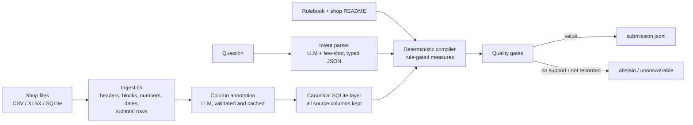

# DataMate: question answering over messy business spreadsheets

A system for the **Zalo AI Challenge 2026 – DataMate** task: answer Vietnamese business questions over small-business
data (CSV, Excel, SQLite) using the split's own `rulebook.md` and each shop's `README.md`.

The design principle is simple: **the language model reads and classifies, deterministic code computes.** The model never
writes free-form SQL. It annotates columns once and turns each question into a typed *intent*; a rule-driven compiler
then calculates the answer from the shop's own data, and quality gates prefer `abstain` or `unanswerable` over a guess.

* One offline model: `google/gemma-4-12B-it` (11.96 B parameters, Apache-2.0, released 2026-06-03), 4-bit NF4 with an
  fp16 fallback. No fine-tuning, no external service, no network at inference.
* Scoring: correct `+1`, wrong `−1`, abstain `0`; `PA = (correct − wrong) / total`.

> **Status and honesty note.** Numbers in [`docs/EVALUATION.md`](docs/EVALUATION.md) were measured on the *public* split
> and mostly on shops that were inspected question by question while developing. They are an optimistic upper bound
> and are **not** evidence of private-set accuracy. See [`docs/COMPLIANCE.md`](docs/COMPLIANCE.md) for the rule-by-rule
> mapping and the known open risks.

## Contents

| Path | What it is |
|---|---|
| [`source_test/bizreason/`](source_test/bizreason) | The Python package (ingestion, semantic layer, compiler, solver, orchestration) |
| [`source_test/serve/`](source_test/serve) | Local model server (one worker per GPU) and the Kaggle-hosted API controller used during development |
| [`source_test/container/`](source_test/container) | Container entry point and GPU pre-flight check |
| [`source_test/tests/`](source_test/tests) | Test suite (2,300+ tests, no model or network needed) |
| [`docker/`](docker) | Everything needed to build and export the submission image |
| [`docs/`](docs) | Architecture, Docker guide, development guide, evaluation protocol, compliance |

## Pipeline at a glance



Details: [`docs/ARCHITECTURE.md`](docs/ARCHITECTURE.md).

## Quick start (development)

Requirements: Python 3.11+, no GPU needed for the tests.

```bash
cd source_test
python -m venv .venv && source .venv/bin/activate
pip install -e ".[dev]"
python -m pytest -o addopts="" -q          # full suite
```

Run the pipeline against an OpenAI-compatible model endpoint (for example a hosted Gemma 4 12B):

```bash
cd source_test
python -m bizreason.run_v2 \
  --data /path/to/test_root \            # questions.jsonl, rulebook.md, calendar.csv, data/<business_id>/
  --out  /path/to/work_dir \             # caches, checkpoints, submission.jsonl
  --connection connection.json \         # {"model": ..., "bearer_token": ...}
  --endpoint-file endpoint.json \        # {"base_url": ".../v1"}
  --fewshot-bank /path/to/fewshot_bank.jsonl --fewshot-k 4 \
  --workers 4 --traces
```

`--help` lists every switch. The defaults are the measured configuration: aliases off, value linking, column
measures, rulebook terms and definitions on; plan fallback, SQL fallback, consensus, reasoning, answer gate and time
reader **off**.

## Offline run, as the organizers run it

```bash
python source_test/run_submission.py \
  --data <test_root> --model-dir <model_dir> --out <work_dir> \
  --submission <work_dir>/submission.jsonl --fewshot-bank <fewshot_bank.jsonl> \
  --total-seconds 21000 --workers 4
```

This starts one model worker per GPU, waits for warm-up, runs the pipeline, writes `submission.jsonl` after every
answer and per-question logs under `<work_dir>/logs/`. See [`source_test/SUBMISSION.md`](source_test/SUBMISSION.md).

## Docker submission

The final solution is a single `linux/amd64` image (`/code/predict.sh`, `/data` in, `/result` out). The weights are
streamed into the exported archive from Hugging Face with a SHA-256 check, so the build host never stores 24 GB of
weights. Build, export and verification steps, with the pitfalls we hit, are in [`docs/DOCKER.md`](docs/DOCKER.md) and
[`docker/README.md`](docker/README.md).

```bash
make -C docker context EXTRA=<training-data-and-bank-dir>
make -C docker image TAG=<tag>
```

## Repository rules that matter

1. **No dataset literals.** No business IDs, question IDs, product names, hashes or fixed dates in the code. A test
   (`tests/test_no_dataset_literals.py`) guards this; it does not replace review.
2. **Conventions come from the current rulebook.** Industry rules apply only when the rulebook or README at run time
   states them; otherwise the measure abstains. See *Rulebook gates* in the architecture guide.
3. **No test data in git.** Datasets, gold files, traces, caches and SQLite layers are ignored; never commit them.
4. **A change counts only after a measured, same-snapshot comparison.** See [`docs/EVALUATION.md`](docs/EVALUATION.md).

## Tiếng Việt (tóm tắt)

Hệ thống trả lời câu hỏi tiếng Việt trên bảng tính doanh nghiệp. Model Gemma 4 12B chỉ **đọc và phân loại** (chú thích
cột, biến câu hỏi thành intent có kiểu); mã xác định **tính toán** đáp án từ dữ liệu của chính shop và rulebook cấp lúc
chạy. Khi không đủ căn cứ, hệ thống trả `abstain` hoặc `unanswerable` thay vì đoán. Chạy offline hoàn toàn; không
fine-tune. Xem `docs/` để biết kiến trúc, cách build Docker, quy trình đánh giá và đối chiếu luật thi.

## License

No license has been chosen for this repository yet; all rights reserved by the authors until one is added.
The model weights are Apache-2.0 (Google).
