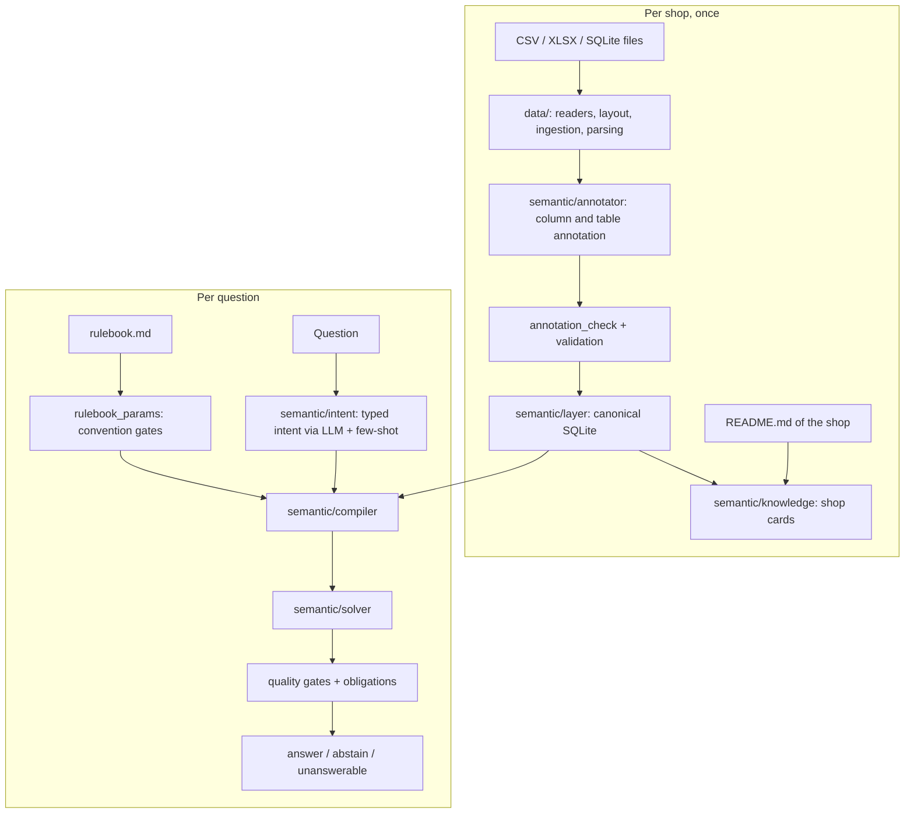

# Architecture

The system separates *understanding* (model) from *computing* (code). The model never produces an answer value and never
writes free-form SQL; it produces structured, validated descriptions that deterministic code turns into numbers.

## 1. Ingestion (`bizreason/data/`)

Shops' files are hand-made: shifted headers, two-row headers, blocks of different tables on one sheet, mixed date
formats (text, Excel serials, localized strings), thousands separators of either convention, subtotal rows.

* `readers.py`, `layout.py`: read sheets, detect header rows and table blocks, drop subtotal/total rows while
  keeping continuation rows of multi-line orders (`BlockSums` cross-checks block totals).
* `parsing.py`, `normalization.py`: numbers (locale inferred from the data), dates, units; `vocabulary.py` holds
  the business vocabulary, the only place where Vietnamese word lists live.
* `identities.py`: unifies customer identity keys (name plus phone) across sheets.
* `catalog.py`, `schema.py`, `row_audit.py`: describe what was read and audit row counts and sums.

Invariant: every transformation must preserve row counts, date ranges, money totals and quantity totals of the source.

## 2. Semantic layer (`bizreason/semantic/`)

* `annotator.py` asks the model, once per shop, to annotate columns and tables (role, status columns, row kinds,
  value groups, README conventions). Output is checked (`annotation_check.py`, `definition_checks.py`) and cached.
* `layer.py` builds the **canonical SQLite**: canonical tables plus the extended source data (`x_*` columns,
  numeric/date companions, `src_*`, `column_catalog`, `shop_docs`, `shop_facts`). Unknown columns are never thrown
  away just because no canonical measure exists for them.
* `debt_sources.py`, `stock_sources.py`, `obligations.py`: derive receivables, instalments and stock from ledgers.

## 3. Question → intent → compiler → solver

1. `intent.py` builds a prompt with few-shot examples retrieved from the training split (`fewshot.py`; same shop and
   same source question are excluded) and asks the model for a typed intent: measure, dimensions, filters, period,
   answer type.
2. `value_linking.py` / `value_resolver.py` match filter values against the shop's own data at run time. Matches are
   verifiable and logged; they are not literals in source code.
3. `compiler.py` maps the intent to parameterized SQL over the canonical layer. Measures that depend on
   conventions (net or gross revenue, which statuses count, how debt ages, stock units) are **gated** by
   `rulebook_params.py`/`conventions.py`: a convention applies only if the rulebook or shop README given at run time
   supports it, otherwise the measure is withheld.
4. `solver.py` executes, formats (`formatting.py`) and checks the result.
5. Quality gates (`quality.py`, `answer_gate.py`, `verify.py`) can turn a result into `abstain` or `unanswerable`.

`unanswerable` means the data or rulebook genuinely do not record the requested thing. `abstain` means the system
cannot represent or trust an answer. They are different and reported separately.

## 4. Fallback path (off by default)

`semantic/knowledge.py` builds knowledge cards from the shop's data and README; `semantic/plan.py` accepts a typed
query plan and compiles it to SQL, checking tables, columns, values, time, join keys and row-multiplication risk.
`--plan-fallback` and `--sql-fallback` exist but are **off** in the measured and submitted configuration: they have
unit tests but no end-to-end evidence yet. Self-checking a plan does not guarantee it is semantically right.

## 5. Orchestration and serving

| Module | Role |
|---|---|
| `bizreason/run_v2.py` | Runs a whole test root: shops, caches, workers, checkpoints, traces, `submission.jsonl` |
| `serve/local_server.py` | OpenAI-compatible server around one Hugging Face model per GPU (NF4 or fp16) |
| `run_submission.py` | Offline orchestrator: starts one worker per GPU, warm-up, time budget, writes outputs |
| `container/predict.py`, `container/gpu_preflight.py` | Container entry point; pre-flight picks NF4 or fp16 by a real kernel test |
| `serve/model_api.py` | Development tool: hosts the model on Kaggle GPU sessions behind a gateway (not used in the submission) |

## 6. Design rules

* No dataset literals in code (IDs, hashes, product or customer names, fixed dates). Values are matched against the
  shop's own data at run time. Vocabulary belongs to `vocabulary.py`.
* Industry conventions apply only if the current rulebook/README supports them; rulebooks can change between splits.
* "SQL ran" and "two passes agree" are not correctness evidence. Distinguish infrastructure failures, misunderstood
  questions, questions outside what can be represented, and truly unanswerable ones.
* Do not return defaults to hide missing data; abstain instead.

Known limits: month, weekday and hour grouping and multi-period targets in the fallback plan; ratios across two
different sources; incomplete canonical-column descriptions. See [`EVALUATION.md`](EVALUATION.md) for measured
weaknesses (subtotal rows and column re-ordering).
